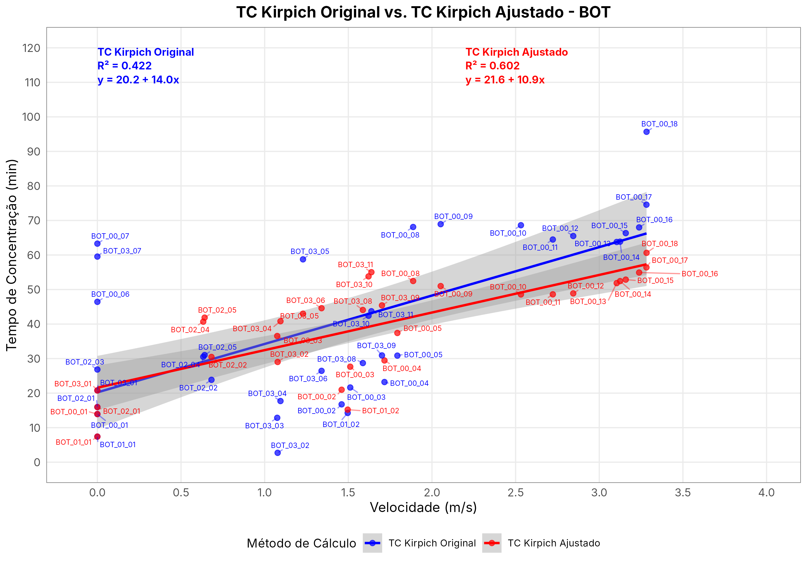

# Tempo de concentração (Kirpich) × velocidade

Análise em R que compara o **tempo de concentração (TC) calculado por Kirpich**, na forma original e na forma ajustada, com a **velocidade de escoamento** em cada trecho (TC) da área de estudo.

O script:

- ajusta uma regressão linear `TC ~ Velocidade` para cada método;
- gera um gráfico de dispersão com o nome de cada trecho, as retas de regressão, o R² e a equação;
- gera os gráficos de diagnóstico dos resíduos;
- salva uma tabela com os coeficientes (intercepto, inclinação, R², p-valor).



## Estrutura

```
.
├── dados/
│   └── tc_bot.csv              # dados de entrada
├── R/
│   └── analise_tc_kirpich.R    # script da análise
├── figuras/                    # gráficos gerados (PNG)
└── resultados/                 # tabela das regressões (CSV)
```

## Como rodar

1. Clone o repositório e abra a pasta no RStudio (ou use `setwd()` na pasta raiz).
2. Rode:

```r
source("R/analise_tc_kirpich.R")
```

Os pacotes `ggplot2`, `dplyr`, `tidyr` e `ggrepel` são instalados automaticamente se não estiverem disponíveis.

## Formato dos dados

O CSV precisa ter as colunas:

| Coluna | Descrição |
|---|---|
| `Nome_TC` | identificador do trecho (ex.: `BOT_00_01`) |
| `Velocidade_ms` | velocidade de escoamento (m/s) |
| `TC_min_kirpich_original` | TC por Kirpich original (min) |
| `TC_min_kirpich_ajustado` | TC por Kirpich ajustado (min) |

Para analisar outra área, crie um novo CSV em `dados/` e mude `arquivo_dados` e `nome_area` no início do script.

## Parâmetros

No início do script:

| Parâmetro | Padrão | Efeito |
|---|---|---|
| `zeros_como_na` | `TRUE` | TC = 0 é tratado como dado faltante e fica fora da regressão |
| `excluir_v_zero` | `FALSE` | se `TRUE`, remove os trechos com velocidade = 0 |

## Resultados (BOT, configuração padrão)

| Método | n | Equação | R² | p-valor |
|---|---|---|---|---|
| Kirpich Original | 36 | y = 20,2 + 14,0x | 0,422 | 1,8 × 10⁻⁵ |
| Kirpich Ajustado | 32 | y = 21,6 + 10,9x | 0,602 | 1,8 × 10⁻⁷ |

## Autora

Kamila Almeida dos Santos
